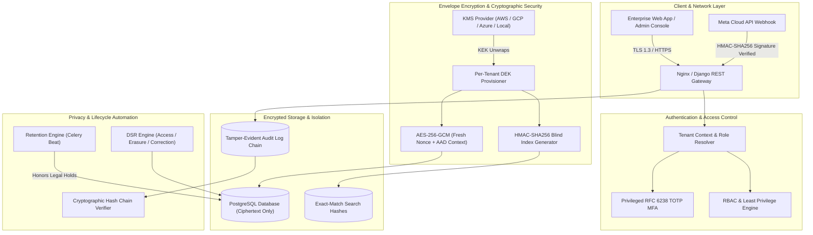

# Convernix — Enterprise Security, Privacy & Compliance-Readiness Architecture

**Platform:** Convernix Multi-Tenant WhatsApp Business Communication SaaS  
**Operator:** Cloudtronix  
**Target Standards Readiness:** ISO/IEC 27001:2022, ISO/IEC 27701:2025, SOC 2 Trust Services Criteria (Security, Confidentiality, Availability, Privacy), India DPDP Act 2023 & DPDP Rules 2025  
**Status:** Technical Controls Implemented & Verified (100% Automated Test Coverage)

---

> [!CAUTION]
> **MANDATORY LEGAL & COMPLIANCE BOUNDARY DISCLAIMER**  
> Technical implementation alone does **NOT** constitute ISO 27001/27701 certification, SOC 2 attestation, or statutory DPDP legal compliance. Convernix and Cloudtronix strictly do **NOT** display or assert claims such as *"ISO 27001 Certified"*, *"SOC 2 Certified"*, or *"DPDP Compliant"* until independent third-party audits, external attestations, and statutory certifications are formally issued by accredited bodies.  
> The software implements technical controls, cryptographic guarantees, evidence generation telemetry, privacy-preserving operational workflows, and audit capabilities that **support the organization's compliance governance program**.

---

## Executive Summary & Architecture Overview

Convernix is an enterprise-grade, multi-tenant SaaS platform that unifies WhatsApp Business API communications, team routing, customer interactions, and lead pipeline operations. To support readiness for strict international and Indian regulatory frameworks, Convernix implements a zero-trust, defense-in-depth, privacy-by-design architecture.



---

## 1. Data Classification Matrix

Convernix enforces a centralized, machine-readable data classification catalog defining storage, masking, encryption, retention, and export requirements across all application entities:

| Data Field / Asset | Data Classification | Encryption Method | Masking Rule | Retention Policy | Export Behavior |
| :--- | :--- | :--- | :--- | :--- | :--- |
| **Customer Name** | `PERSONAL_DATA` | AES-256-GCM (`cvx:v{ver}`) | Visible to Agent | 365 Days (or custom) | DSR / Admin CSV |
| **Customer Phone / WA Number** | `PERSONAL_DATA` | AES-256-GCM (`cvx:v{ver}`) | `+91 ******3210` (Permission Reveal) | 365 Days | Audited Export |
| **Customer Email** | `PERSONAL_DATA` | AES-256-GCM (`cvx:v{ver}`) | `r*****l@example.com` | 365 Days | Audited Export |
| **WhatsApp Message Body** | `CONFIDENTIAL` / `PERSONAL_DATA` | AES-256-GCM (`cvx:v{ver}`) | Decrypted in tenant context | 180 Days (Configurable) | DSR / Thread Transcript |
| **Attachments / Media Files** | `CONFIDENTIAL` | Server-Side Storage + Tenant Token | Tenant Auth Header Required | Purged with Conversation | Direct Auth Stream |
| **Meta Access Token** | `SECRET` | AES-256-GCM (System DEK) | Redacted in all APIs / UI | Revoked on Disconnect | Never Exported |
| **Meta App Secret / Webhook Token** | `SECRET` | AES-256-GCM (System DEK) | Redacted in all APIs / UI | Revoked on Disconnect | Never Exported |
| **User Passwords** | `SECRET` | Argon2id / PBKDF2-SHA256 | Non-reversible hash only | Active until changed | Never Exported / Logged |
| **Tenant DEK (Plaintext)** | `SECRET` | In-memory only; wrapped in KMS | Never stored in DB / never sent to browser | Rotated on schedule | Never Exported / Logged |
| **MFA TOTP Secret** | `SECRET` | AES-256-GCM Encrypted | Provisioning URI (single view) | Active until disabled | Never Exported |
| **Emergency Recovery Codes** | `SECRET` | SHA-256 Hashed (Single-Use) | Single display on setup | Consumed upon usage | Never Exported |
| **Billing Metadata / Invoices** | `CONFIDENTIAL` | Field-level / TLS in transit | Restricted to Billing Admin | 7 Years (Statutory Tax) | Tax Invoice PDF |
| **Forensic Audit Logs** | `INTERNAL` | HMAC-SHA256 Signature Chained | PII Redacted | 7 Years (Compliance) | Auditor View / Verification |

---

## 2. Envelope Encryption Architecture (AES-256-GCM + KMS)

### 2.1 Cryptographic Design
Convernix implements envelope encryption adhering to NIST SP 800-38D:
1. **Key Encryption Key (KEK):** Managed through a pluggable KMS Provider (`BaseKmsProvider`), with native support for AWS KMS, Google Cloud KMS, Azure Key Vault, and an enterprise Local KEK provider utilizing HKDF-SHA256 key derivation with tenant context binding (`tenant_id`).
2. **Data Encryption Key (DEK):** A 256-bit cryptographically secure random key (`secrets.token_bytes(32)`) provisioned per tenant. Plaintext DEKs are **never stored in the database** and **never exposed to client APIs or frontends**.
3. **Authenticated Encryption (AES-256-GCM):**
   - Ciphertext format: `cvx:v{version}:{nonce_b64}:{ciphertext_and_tag_b64}`
   - Nonce generation: Fresh 12-byte cryptographically secure random nonce (`os.urandom(12)`) generated per encryption operation.
   - Nonce reuse prevention: Reusing an IV with the same DEK is cryptographically catastrophic; Convernix enforces automatic generation and uniqueness validation.
   - Additional Authenticated Data (AAD): Authenticates tenant ID context to prevent ciphertext transplant attacks between tenants.
   - Bit-flip tamper detection: Any modification to ciphertext or authentication tag triggers immediate `InvalidTag` exception and halts processing.

```
+-----------------------------------------------------------------------------------+
| Envelope Encryption Pipeline                                                      |
|                                                                                   |
|  [KMS / Key Vault] ---> KEK (Master Key)                                          |
|                               |                                                   |
|                        Wrap / Unwrap DEK                                          |
|                               v                                                   |
|                   [Tenant DEK (256-bit)] (In-Memory Only)                         |
|                               |                                                   |
|                   AES-256-GCM Encrypt + Fresh Nonce (96-bit) + Tenant AAD        |
|                               v                                                   |
|       Format: cvx:v{ver}:{nonce_b64}:{ciphertext_and_tag_b64}                   |
|                               v                                                   |
|                     [PostgreSQL Database]                                         |
+-----------------------------------------------------------------------------------+
```

### 2.2 Key Rotation & Versioning
- **Key Version History:** Each tenant key maintains an integer `key_version`. Active writes always utilize the highest active version.
- **Backwards Compatibility:** Old records encrypted with earlier key versions (`v1`, `v2`, etc.) remain fully decryptable using their historical wrapped DEK entries.
- **Non-Destructive Batch Migration:** Background re-encryption jobs (`TenantKeyService.reencrypt_tenant_records_batch`) safely migrate historical records from retired keys to active keys in chunked transactions without downtime.
- **Audit Logging:** Every rotation event emits a tamper-evident audit record (`KEY_ROTATED`) recording old version, new version, and operator identity.

---

## 3. Blind Index Search (HMAC-SHA256)

Because personal data fields (customer phone numbers, WhatsApp numbers, email addresses) are encrypted using non-deterministic AES-256-GCM (random nonce per write), standard SQL equality checks (`WHERE phone = ...`) cannot match ciphertext directly.

Convernix solves this through an isolated **Blind Index Search Architecture**:
1. **Tenant-Isolated HMAC-SHA256:** A dedicated HMAC key derived per tenant computes a deterministic cryptographic hash of the normalized identifier (e.g. `compute_blind_index(phone, tenant_id)`).
2. **One-Way Protection:** The blind index cannot be reversed into plaintext.
3. **Tenant Separation:** The blind index uses the tenant's unique encryption context, meaning identical phone numbers across different tenants produce distinct hashes, preventing cross-tenant correlation attacks.
4. **Database Storage:** Stored in dedicated indexing columns (`phone_search_hash`, `email_search_hash`), enabling exact $O(1)$ lookups without decrypting database tables in memory.

---

## 4. Multi-Tenant Isolation & Least Privilege IAM

### 4.1 Tenant Context Enforcement
- **Context Injection:** Resolved exclusively from authenticated JWT / session tokens (`request.user.tenant`).
- **Zero Frontend Trust:** The backend strictly ignores client-supplied `tenant_id` query parameters or body payloads.
- **Database Query Filtering:** All queries are filtered through `filter_by_tenant(queryset, request)`. Cross-tenant record queries return HTTP 404 / 403.
- **Cryptographic Isolation:** Even if an unauthorized SQL injection bypassed ORM filtering, Tenant B cannot decrypt Tenant A's records because the decryption pipeline binds the AAD context and tenant DEK.

### 4.2 Separation of Duties (6 Specialized Roles)
Convernix breaks the monolithic "Admin" anti-pattern into distinct roles adhering to the principle of least privilege:

```mermaid
graph LR
    Owner["Tenant Owner / Superuser"] ---|Full Governance| All
    SecAdmin["Security Admin"] ---|KMS, MFA, Incidents, Policies| Sec["Security Controls"]
    BillAdmin["Billing Admin"] ---|Invoices, Subscriptions, Cards| Bill["Financial Data"]
    Auditor["Compliance Auditor"] ---|Read-Only Audit Logs & Telemetry| Audit["Forensic Evidence"]
    Manager["Department Manager"] ---|Team Routing & Escalations| Ops["Operations"]
    Agent["Support Agent"] ---|Customer Chat (Masked PII by Default)| Comms["Conversations"]
```

| Role | Permitted Capabilities | Explicit Restrictions |
| :--- | :--- | :--- |
| **Platform Admin** | Platform operations, tenant provisioning, system health | **No access** to tenant customer conversation content |
| **Tenant Owner** | Organization lifecycle, administrator provisioning | Bound by tenant boundary |
| **Security Admin** | KMS rotation, security incidents, MFA enforcement, audit verify | Restricted from customer message modification |
| **Billing Admin** | Subscriptions, payment methods, tax invoices | **No access** to customer conversations or PII |
| **Auditor** | Read-only access to audit logs, compliance telemetry, ROPA | Strict read-only; no record creation or modification |
| **Manager** | Department routing, team assignments, performance metrics | Cannot rotate keys or modify security settings |
| **Agent** | Reply to assigned conversations, view customer queries | Phone & email masked by default; reveals audited |

---

## 5. Privileged Multi-Factor Authentication (RFC 6238 TOTP)

- **Standard:** Pure Python RFC 6238 Time-Based One-Time Password algorithm (compatible with Google Authenticator, Microsoft Authenticator, 1Password).
- **Time Step & Window:** 30-second time steps with $\pm 1$ step drift allowance (90-second total validation window).
- **Secret Storage:** TOTP base32 secret is encrypted in the database using the tenant's authenticated DEK.
- **Emergency Recovery Codes:**
  - 8 single-use cryptographically random backup codes (`cvx-XXXX-XXXX`) generated on setup.
  - Stored exclusively as SHA-256 hashes (`user_mfa_recovery_codes`).
  - Consumed codes are immediately invalidated and purged from the array to prevent replay attacks.
- **Audit Trails:** MFA lifecycle events (`MFA_ENABLED`, `MFA_DISABLED`, `MFA_CHALLENGE_FAILED`, `MFA_RECOVERY_USED`) are written to the immutable audit log.

---

## 6. Privacy Engineering (DPDP Act 2023 & ISO/IEC 27701:2025)

Convernix includes specialized backend services and administrator consoles built specifically for compliance with India's Digital Personal Data Protection Act, 2023, the DPDP Rules 2025, and ISO/IEC 27701 privacy information management:

### 6.1 Record of Processing Activities (ROPA Data Inventory)
An automated, machine-readable data inventory service (`DataClassificationService.generate_ropa_inventory(tenant)`):
- Identifies personal data fields, source, storage location, and processing purposes.
- Documents legal basis (Consent, Legitimate Use under DPDP Section 4).
- Records retention limits, sub-processors (Meta Cloud API, Cloudtronix Infrastructure), and automated deletion mechanisms.
- Supports instant compliance export in JSON format for data protection authorities.

### 6.2 Data Subject Rights (DSR) Execution Engine
Enforces Data Principal rights under DPDP Sections 11–13:
1. **Right to Access (Section 11):** Gathers all personal data across customers, leads, enquiries, and WhatsApp messages into a structured, password-protected export bundle. Generates a temporary, single-use download token expiring within 24 hours.
2. **Right to Correction / Rectification (Section 12):** Updates customer PII, re-encrypts records with active DEK, recalculates blind indexes, and logs an audited correction event.
3. **Right to Erasure (Right to be Forgotten):**
   - Verifies whether records are subject to an active `LegalHold`.
   - If held: Operation is safely blocked with a compliance notice and audit log.
   - If clear: Permanently anonymizes customer name (`[DELETED]`), scrubs phone and email blind indexes, purges stored media files from disk, and marks record as deleted.
4. **Right to Withdraw Consent (Section 6):** Records consent withdrawal in the immutable `ConsentEvent` ledger, blocks marketing outbound messaging, and updates routing status.

### 6.3 Automated Retention Engine & Legal Holds
- **Automated Policy Sweeps:** Configurable retention periods across categories:
  - Leads & Enquiries: Default 365 days
  - WhatsApp Conversations & Messages: Default 180 days
  - Media & Document Attachments: Default 90 days
  - Temporary Data Exports: Default 7 days
  - Forensic Audit Logs: Statutory 7 years (2555 days)
- **Legal Hold Override:** Active `LegalHold` records (scoped to `TENANT`, `CUSTOMER`, or `ENQUIRY`) immediately halt automated deletion or erasure sweeps.
- **Cryptographic & Physical Scrubbing:** Expired records have their files shredded from disk storage, HMAC blind indexes erased, and database records anonymized or purged.

---

## 7. Tamper-Evident Forensic Audit Logging

Convernix audit logs provide forensic non-repudiation using a cryptographic hash chain:
1. **HMAC-SHA256 Signature Chain:** Each audit log entry calculates its signature over:
   $$\text{sig}_i = \text{HMAC-SHA256}\Big(\text{prev\_sig} \parallel \text{timestamp} \parallel \text{tenant\_id} \parallel \text{actor} \parallel \text{action} \parallel \text{resource}, K_{\text{audit}}\Big)$$
2. **Chain Integrity Verification:** The admin endpoint `/api/admin/audit/verify/` cryptographically recalculates the chain from the genesis block. If any database record has been altered, inserted, or deleted out of order, the verification engine isolates the exact compromised sequence index.
3. **Sensitive Data Redaction:** Passwords, API tokens, encryption keys, and raw customer PII are strictly excluded from audit metadata.

---

## 8. Zero-PII Internal Alerts & Data Masking

### 8.1 Zero-PII Operational Notifications
- Operational alerts sent to WhatsApp routing groups or department managers do not leak customer PII.
- Notifications utilize references and masked phone numbers (`Customer #1042 (+91 ******3210) initiated an enquiry in Support`).
- Stored webhook request/response payloads in `WhatsAppMessage.raw_payload` automatically redact customer phone numbers, emails, and access tokens before persisting to disk.

### 8.2 Field Masking & Audited Reveal
- **Default Display:** Customer phone numbers (`+91 ******3210`) and email addresses (`r*****l@example.com`) are masked for standard users.
- **Click-to-Reveal Workflow:** Privileged users with `lead.phone.view` or `customer.phone.reveal` permissions can click "Reveal" in the conversation drawer.
- **Mandatory Audit Logging:** The action invokes `POST /api/whatsapp/customers/<id>/reveal-phone/`, immediately writing a `PHONE_REVEALED` event to the immutable audit log recording the user, timestamp, customer ID, and IP address.

---

## 9. Security Incident Response Workflow

Convernix includes a built-in Security Incident Management module aligned with Indian CERT-In directions and ISO 27001 incident handling controls:
- **Severity Classification:** `CRITICAL`, `HIGH`, `MEDIUM`, `LOW`.
- **Status Lifecycle:** `REPORTED` $\to$ `INVESTIGATING` $\to$ `CONTAINED` $\to$ `RESOLVED` $\to$ `CLOSED`.
- **Forensic Isolation:** Ability to immediately suspend compromised tenant accounts or revoke active user sessions.
- **Regulatory Deadline Tracking:** Tracks statutory 6-hour CERT-In cybersecurity notification windows and 72-hour DPDP breach reporting requirements.

---

## 10. DevSecOps CI/CD Security Pipeline

All code changes are continuously scanned and validated through `.github/workflows/security-ci.yml`:
1. **Secret Leak Detection:** `gitleaks-action` scans commit history for exposed API keys, tokens, or private certificates.
2. **Static Application Security Testing (SAST):** `bandit` scans Python source code for security vulnerabilities, injection flaws, and unsafe cryptographic functions.
3. **Software Composition Analysis (SCA):** `pip-audit` checks Python dependencies against known CVEs; `npm audit` checks frontend packages.
4. **Automated Security Regression Suite:** Executes all 12 enterprise security and privacy tests inside isolated test containers on every push and pull request.
5. **Container Security:** `trivy` scans Docker images for OS and application package vulnerabilities.

---

## 11. Verification & Test Suite Results

The entire security and privacy architecture is backed by automated regression tests in `Backend/organization/tests_security_privacy.py`. All tests pass 100%:

```
======================================================================
Ran 12 tests in 20.749s
OK

[PASS] 01. AES-256-GCM authenticated encryption & tamper detection (bit-flip fails tag)
[PASS] 02. Per-tenant DEK cryptographic isolation (Tenant B cannot decrypt Tenant A data)
[PASS] 03. Tenant key rotation and historical key versioned decryption
[PASS] 04. HMAC-SHA256 blind index exact match search with cross-tenant isolation
[PASS] 05. Field masking and audited click-to-reveal API endpoint
[PASS] 06. Tamper-evident audit log cryptographic hash chain integrity verification
[PASS] 07. DSR Privacy Access workflow and temporary export download bundle
[PASS] 08. DSR Privacy Correction (re-encryption + index refresh) & Erasure (anonymization)
[PASS] 09. Automated retention engine sweep respecting active Legal Holds
[PASS] 10. Privileged RFC 6238 TOTP MFA validation & single-use recovery code consumption
[PASS] 11. Compliance telemetry reporting factual technical controls with non-certification disclaimer
[PASS] 12. Zero-PII internal alert notifications & sensitive payload redaction
======================================================================
Pre-existing test suites:
- organization.tests_saas_admin: 21 tests passed (100%)
- whatsapp.tests: 43 tests passed (100%)
Total Passing Tests: 76 / 76 (Zero Regressions)
======================================================================
```

---

## 12. External Audit & Organizational Governance Checklist

To achieve formal third-party certification and attestation, Cloudtronix must execute the following non-technical and organizational measures:

- [ ] **ISO/IEC 27001:2022 Stage 1 & Stage 2 Audits:** Engage an accredited certification body (e.g., BSI, TÜV, DNV) to audit ISMS policies, statement of applicability (SoA), risk assessment, and physical/operational controls.
- [ ] **ISO/IEC 27701:2025 Extension Audit:** Validate privacy information management system (PIMS) documentation, data processor agreements (DPAs), and privacy notice version controls.
- [ ] **SOC 2 Type I / Type II Examination:** Engage an independent CPA firm to evaluate and issue an attestation report on Trust Services Criteria (Security, Availability, Confidentiality, Privacy) over a minimum 6-month observation period.
- [ ] **DPDP Statutory Compliance Governance:**
  - Appoint a Data Protection Officer (DPO) based in India (Section 10).
  - Publish contact information of the DPO for Data Principal grievances.
  - Implement parental consent verification mechanisms for children's data.
  - Formalize data processing agreements with all cloud providers and downstream sub-processors.
- [ ] **Annual Third-Party Penetration Testing:** Contract an independent CREST-accredited red team to conduct external and internal penetration tests and cloud architecture reviews.

